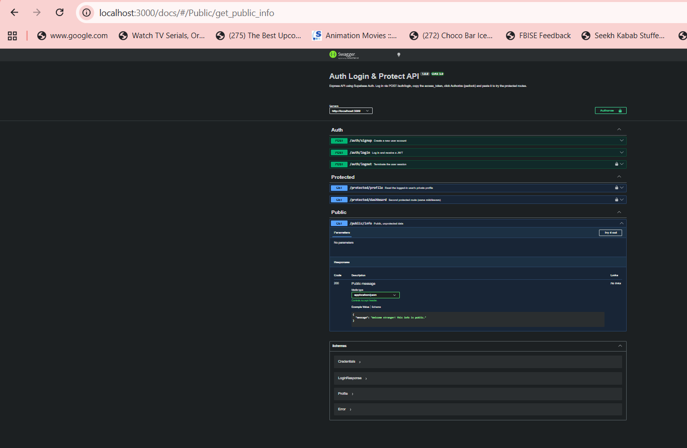

# Auth Login & Protect API

A small Express API that handles **sign up, log in and log out** with [Supabase Auth](https://supabase.com/auth) and protects private routes by verifying the user's **JWT** (Bearer token). Supabase acts as the Identity Provider, so no passwords or cryptography are handled in this codebase.

## How it works

1. The client sends email + password to `POST /auth/login`.
2. The server asks Supabase to validate them and returns an **access token** (JWT) and a refresh token.
3. The client sends the access token on protected requests: `Authorization: Bearer <token>`.
4. A reusable middleware (`src/middleware/requireAuth.js`) verifies the token with Supabase (`supabase.auth.getUser(token)`). Valid token: the route runs. Missing, malformed, tampered or expired token: `401`.

## Tech stack

Node.js 18+, Express 5, `@supabase/supabase-js`, `dotenv`, `swagger-ui-express`.

## Setup

1. Create a free project at [supabase.com](https://supabase.com).
2. Copy your **Project URL** and **anon key** from *Project Settings → API*.
3. Clone this repo and install dependencies:
   ```bash
   git clone <your-repo-url>
   cd auth-login-protect
   npm install
   ```
4. Create your environment file and fill in your values:
   ```bash
   cp .env.example .env        # Windows PowerShell: copy .env.example .env
   ```
   ```env
   SUPABASE_URL=your_project_url
   SUPABASE_KEY=your_anon_key
   PORT=3000
   ```
   `.env` is listed in `.gitignore`. Never commit your keys.
5. (Recommended for testing) In Supabase go to *Authentication → Sign In / Providers → Email* and turn off **Confirm email**, otherwise new users must click an email link before they can log in.

## Run

```bash
npm start
```

You should see `Server running and connected to Supabase`. Then open **http://localhost:3000/docs** for the Swagger UI.

## API reference

| Method | Endpoint | Auth required | Description | Success | Errors |
|---|---|---|---|---|---|
| POST | `/auth/signup` | No | Create an account | `201` + user | `400` missing fields |
| POST | `/auth/login` | No | Log in, returns JWT | `200` + tokens | `400` missing fields, `401` bad credentials |
| POST | `/auth/logout` | Yes (Bearer) | End the session | `204` | `401` |
| GET | `/protected/profile` | Yes (Bearer) | Private user profile | `200` | `401` |
| GET | `/protected/dashboard` | Yes (Bearer) | Second protected route | `200` | `401` |
| GET | `/public/info` | No | Public message | `200` | none |
| GET | `/docs` | No | Swagger UI | `200` | none |

`401` messages: `Access token required` (header missing/malformed) and `Invalid or expired token` (Supabase rejected it).

## Try it with curl

```bash
# sign up
curl -i -X POST http://localhost:3000/auth/signup -H "Content-Type: application/json" -d '{"email":"test@example.com","password":"password123"}'

# log in and copy the access_token
curl -i -X POST http://localhost:3000/auth/login -H "Content-Type: application/json" -d '{"email":"test@example.com","password":"password123"}'

# protected route
curl -i http://localhost:3000/protected/profile -H "Authorization: Bearer <PASTE_ACCESS_TOKEN>"
```

> On Windows PowerShell, `curl` is an alias for `Invoke-WebRequest`. Use `curl.exe` instead, or just use Swagger UI.

## Swagger UI

Open `/docs`, click **Authorize** (padlock), paste the `access_token` from `/auth/login`, then use **Try it out** on `/protected/profile`.



## Project structure

```
server.js                      app setup, routes, error handling
openapi.json                   OpenAPI spec (bearerAuth security scheme)
src/supabase.js                Supabase client
src/middleware/requireAuth.js  reusable token-verification middleware
src/routes/auth.js             signup, login, logout
src/routes/protected.js        profile, dashboard
src/routes/public.js           public info
```

## Design notes

- **Fail closed:** if token verification throws, the request is rejected with `401`.
- **Logout:** in supabase-js v2, `auth.signOut()` only clears a session stored inside the client, and this server keeps none. So `/auth/logout` calls Supabase's `/auth/v1/logout` endpoint with the user's own token to revoke the session server-side.
- **Anon key only:** the server never needs the service-role key.
